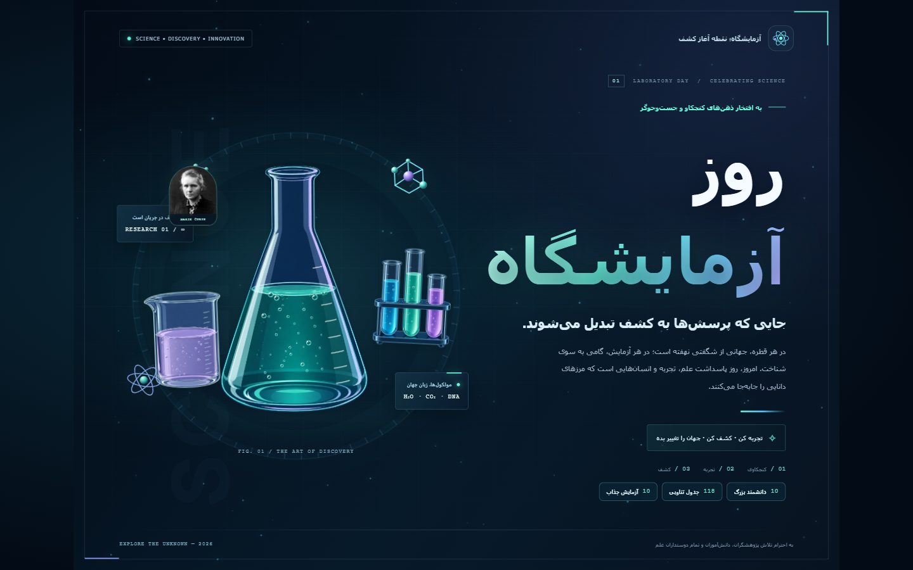

# Laboratory Day — Interactive Persian Science Poster

An animated, responsive Persian poster for Laboratory Day, expanded into a small interactive science museum.



## Features

- Animated glassware and particle effects
- Ten illustrated scientist stories with portraits, timelines, colors, and motion
- Complete interactive periodic table with all 118 elements, search, and category filters
- Ten visual science experiments with materials, steps, and explanations
- Responsive full-screen layout for desktop and mobile
- Local Vazirmatn font files and no build step
- Reduced-motion support and keyboard-accessible controls

## Run locally

Open `index.html` directly in a modern browser. No dependencies or build command are required.

## Project structure

```text
index.html          Main poster and animated hero
interactive.css     Museum panels and responsive styling
interactive.js      Scientists, experiments, and periodic table data
assets/             Local images and fonts
```

## Image and research credits

Scientist portraits were gathered from Wikimedia Commons and Wikipedia source pages. Biographical summaries were cross-checked against Nobel Prize, NASA, the Royal Institution, Newton Project, Darwin Correspondence Project, Museo Galileo, the Royal Society of Chemistry, and Stanford.

The science-experiment atlas and laboratory glassware illustrations were created for this project with OpenAI image generation. Prompt summaries are included under `assets/`.

## License

Source code is released under the MIT License. Third-party portraits and generated image assets retain their respective source or usage terms; see `assets/scientists/sources.json` and the prompt notes in `assets/`.

